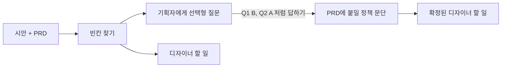

# design-gap-check

디자인 시안과 PRD 사이의 빈칸을 찾아, 기획자에게는 **선택형 질문**으로, 디자이너에게는 **할 일**로 나눠 주는 AI 스킬

## 왜 만들었나

빈 화면, 에러, 정원 마감, 로그인하지 않은 상태 같은 예외 상황은 PRD에는 정책이 없고 시안에는 화면이 없는 경우가 많습니다. 기획자는 디자인에서 알아서 그릴 거라고, 디자이너는 기획에서 정해 줄 거라고 생각하다가 개발 단계에서 문제가 터집니다.

이 스킬은 그 빈칸을 찾아서 **정해야 할 사람에게, 답하기 쉬운 형태로** 넘깁니다.

## 동작 흐름



1. **검수 모드**: 시안과 PRD를 넣으면 빈칸 리포트가 나옵니다.
   - 기획자에게: "인원이 다 찬 스터디는 어떻게 보여줄까요? A) 숨기기 B) 마감 표시 C) ..." 같은 질문과 추천
   - 디자이너에게: 더 그려야 할 화면 목록
2. **반영 모드**: 기획자가 `Q1 C, Q2 A`처럼 답을 보내면 PRD에 그대로 붙여 넣을 정책 문단과 확정된 디자이너 할 일이 나옵니다.

결과 예시는 [examples/study-app/expected-report.md](examples/study-app/expected-report.md)와 [expected-prd-update.md](examples/study-app/expected-prd-update.md)에서 볼 수 있습니다.

## 바로 써 보기

### Claude 앱 (claude.ai)

1. `design-gap-check` 폴더를 **폴더째** zip으로 압축합니다. (윈도우: 폴더 우클릭 > 압축(ZIP) 파일)
2. 설정의 기능(Capabilities) 메뉴에서 코드 실행을 켜고, 스킬 항목에서 zip을 업로드합니다. 메뉴 이름은 앱 버전에 따라 조금 다를 수 있습니다.
3. 새 대화에서 시안 스크린샷과 PRD를 올리고 "빈칸 찾아줘"라고 요청합니다.

### Claude Code

`design-gap-check` 폴더를 아래 중 한 곳에 복사합니다.
- 나만 쓸 때: `~/.claude/skills/design-gap-check/`
- 팀 프로젝트에서 같이 쓸 때: `{프로젝트}/.claude/skills/design-gap-check/`

Figma MCP가 연결되어 있으면 스크린샷 대신 Figma 링크만 넣어도 됩니다.

### ChatGPT (GPTs)

1. GPT 만들기 화면에서 구성(Configure) 탭을 엽니다.
2. **지침**에 [gpt/instructions.md](gpt/instructions.md) 내용을 붙여 넣습니다.
3. **지식**에 아래 4개 파일을 올립니다.
   - `design-gap-check/references/states-checklist.md`
   - `design-gap-check/references/question-guide.md`
   - `design-gap-check/templates/report.md`
   - `design-gap-check/templates/prd-update.md`
4. 미리보기에서 시안 스크린샷과 PRD를 올려 테스트합니다.

### 그 외 AI

`SKILL.md`와 위 4개 파일 내용을 첫 메시지에 붙여 넣고 시작하면 됩니다.

## 폴더 구조

```
design-gap-check/
├─ design-gap-check/            스킬 본체 (이 폴더를 zip으로 올림)
│  ├─ SKILL.md                  언제 쓰는지, 동작 순서
│  ├─ references/
│  │  ├─ states-checklist.md    화면 유형별로 확인할 상태와 원칙 코드
│  │  └─ question-guide.md      기획자 질문 쓰는 법
│  └─ templates/
│     ├─ report.md              검수 결과 형식
│     └─ prd-update.md          PRD 반영 결과 형식
├─ gpt/instructions.md          ChatGPT GPTs용 지침
├─ examples/study-app/          테스트용 입력과 기대 결과
├─ AGENTS.md                    AI 도구용 개발 안내
└─ CLAUDE.md                    Claude Code가 AGENTS.md를 읽게 하는 파일
```

## 같이 개발하는 법

레포를 받아서 각자 쓰는 AI 도구로 열면 됩니다.

```bash
git clone https://github.com/yooaknow/design-gap-check.git
```

- **Claude Code**: 레포 폴더에서 실행하면 `CLAUDE.md`를 통해 `AGENTS.md`의 규칙을 자동으로 읽습니다.
- **Codex**: 레포 폴더에서 실행하면 `AGENTS.md`를 자동으로 읽습니다.
- **Claude 앱, ChatGPT 대화창**: 고칠 파일과 `AGENTS.md`를 함께 올리고 요청합니다.

### 어디를 고치면 무엇이 바뀌나

| 바꾸고 싶은 것 | 고칠 파일 |
|---|---|
| 찾아내는 빈칸의 종류 | `references/states-checklist.md` |
| 질문의 말투, 선택지 수, 우선순위 | `references/question-guide.md` |
| 결과 형식 | `templates/` |
| 동작 순서, 분류 기준 | `SKILL.md`와 `gpt/instructions.md` (둘 다) |

### 고친 뒤 테스트

1. 스킬을 불러온 새 대화에 `examples/study-app/prd.md`와 `screens.md`를 넣고 검수를 요청합니다.
2. 결과를 `expected-report.md`와 비교합니다. 확인할 점은 [AGENTS.md](AGENTS.md)의 "테스트하는 법"에 있습니다.
3. `answers.md`를 보내고 `expected-prd-update.md`와 비교합니다.

## 할 일

- [x] 1단계: 스크린샷이나 화면 설명과 PRD로 빈칸 리포트 만들기
- [x] 반영 모드 초안: 기획자 답을 PRD 문단으로 바꾸기
- [ ] 실제 프로젝트 시안 3개 이상으로 테스트하고, 잘못 잡는 항목 정리
- [ ] 2단계: Figma 링크로 바로 검수 (Figma MCP 연결 환경에서 테스트)
- [ ] 체크리스트 보강: 실제 서비스 사례를 질문 추천 근거로 추가
- [ ] 3단계: 노션 PRD에 자동 반영 (방식 미정)
